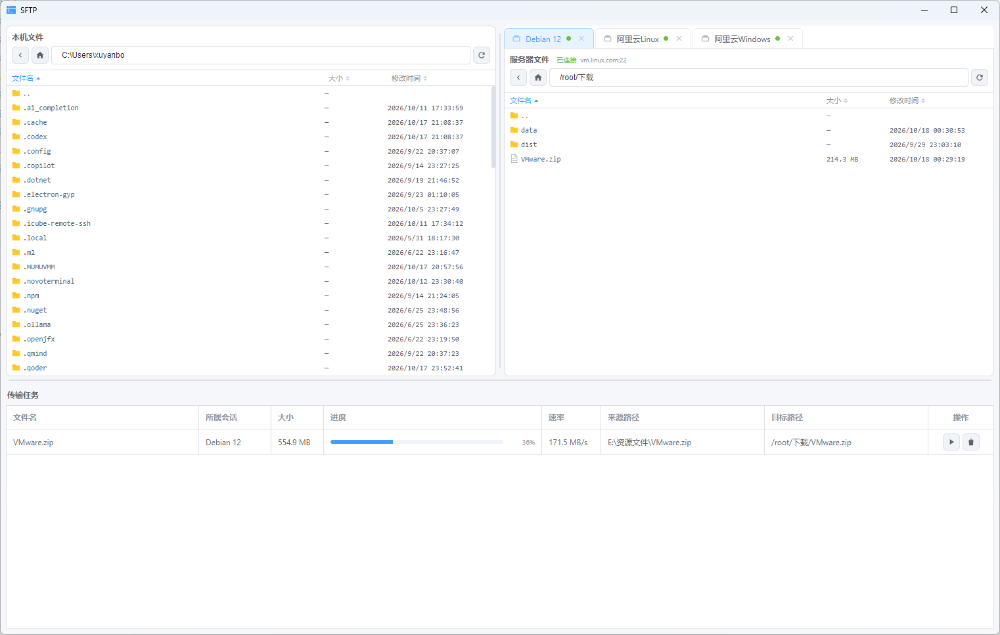
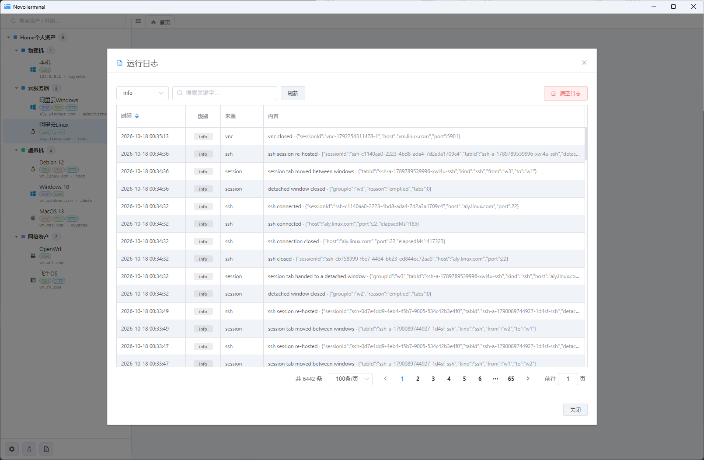

# NovoTerminal

会思考的运维终端：把 SSH 终端、VNC / RDP 远程桌面、SFTP 文件传输和资产凭据管理收进同一个桌面应用，会话以页签编排、可拆成独立窗口，数据全部存在你自己机器上。

A thinking operations terminal: SSH, VNC / RDP remote desktops, SFTP transfers and asset/credential management in one desktop app. Sessions live in tabs, can be detached into their own windows, and all data stays on your machine.

[](./LICENSE)


仓库主页 / Homepage：<https://gitee.com/xu-san333/omni-desk> · <https://github.com/xuyan-bo/OmniDesk>

> 目录 / Contents：[中文](#中文) · [English](#english) · [开发约定](#开发与约定)

---

## 中文

### 界面预览

> 以下图片位待补充：把截图按同名放入 `screenshots/` 即可显示。

| 首页与资产 | SSH 终端 |
| --- | --- |
|  |  |

| VNC 远程桌面 | RDP 远程桌面 |
| --- | --- |
|  |  |

| SFTP 双栏传输 | 传输队列 |
| --- | --- |
|  |  |

| 会话页签拆分为独立窗口 | 运行日志 |
| --- | --- |
|  |  |

| 设置 | 资产高级参数 |
| --- | --- |
|  |  |

### 核心能力

**会话与协议**

- **SSH**：主进程 `ssh2` + 渲染端 xterm 真连接，支持密码 / 私钥交互、首次连接主机密钥确认与保存、终端配色方案、复制粘贴与自适应尺寸。
- **VNC**：主进程建立本地代理，渲染端用 noVNC 内嵌显示，凭据由应用保管，无需外部客户端。
- **RDP 双引擎**：既可以调用系统 `mstsc.exe`（独立窗口），也可以选择内嵌 IronRDP-WASM 画布；引擎与分辨率、色深等参数在资产的高级设置里配置。
- **页签编排**：会话以页签打开，同资产重复打开只激活已有实例；栏内拖拽排序；把会话页签拖出栏外或右键菜单可拆成独立窗口，SSH 会话迁移不断连、输出尾巴会重放，拖回页签栏即重新挂载。

**文件传输（SFTP）**

- 独立窗口承载双栏面板：本机侧与远端侧各自的导航、路径跳转、列头排序（名称 / 大小 / 时间）、`..` 与目录优先。
- 选择交互对齐系统文件管理器：单击替换、Ctrl / Cmd 切换、Shift 范围选、空白处橡皮筋框选、Ctrl / Cmd+A 全选、Esc 清空。
- 传输：单个文件批量上传下载，文件夹聚合成一个可展开的任务树（懒加载渲染、边扫边传），支持暂停 / 恢复 / 取消、覆盖确认、终态任务延时回收。
- 双向拖拽：从系统文件管理器拖入即上传 / 下载；选中多行一起拖动；远端文件可拖出到本机目录。
- 系统剪贴板粘贴：在本机文件管理器复制文件后，在远端目录按 Ctrl / Cmd+V（或右键「粘贴」）上传。

**数据与安全**

- 资产、分组、最近连接与设置统一持久化，凭据经 `safeStorage` 加密后以 JSON 存放；数据路径可自定义并自动迁移。
- 备份与还原：导出 / 导入配置前先做系统身份验证——Windows 走 Hello / 账号密码，macOS 用原生 `LocalAuthentication`（查看可复用 30 秒缓存，导入导出重新认证），Linux 经确认后跳过。
- 运行日志持久化到本地，应用内可查看：连接建立 / 断开 / 失败、IPC 错误、SFTP 任务起止都留有记录，日志不含密码与私钥。
- 提示式更新检查：启动后并发探测 Gitee（仓库 `homepage`）与 GitHub（`githubHomepage`）两处发行版，以 Gitee 为准——它拿到发行版就立刻采用，GitHub 只作兜底且不再等它返回（两平台由 Gitee 自动同步，版本一致），只有 Gitee 请求失败或还没有任何发行版时才用 GitHub 的结果，两路都失败才算检查失败；发现新版才弹窗展示更新内容并提供「前往发布页」，不自动下载安装。可在设置「通用」里关闭，也可在「关于」页手动检查（两边都还没有发行版时提示「发布页还没有可比较的版本」，不是报错）。新版本安装包可直接覆盖旧版（`appId`、`productName` 与安装作用域保持一致即可），不需要先卸载。

**界面与体验**

- 明暗主题，默认跟随系统；中英双语，文案即时切换；支持页面缩放与字体设置。
- 所有可滚动区域统一为细滚动条（含终端、桌面画布与文件列表）。
- 关闭页签 / 窗口时若有活动会话会二次确认，避免误断连。

### 快速开始

```bash
# 1. 安装依赖（国内建议设置 Electron 镜像）
npm install

# 2. 开发：开两个终端，先起 Vite 再起 Electron
npm run dev          # Vite @ http://127.0.0.1:5173
npm run electron     # 另一个终端，连接 dev server

# 3. 生产预览：先构建渲染层，再启动 Electron
npm start

# 4. 打包
npm run pack:win     # Windows（nsis + zip，x64 与 arm64 各一份）
npm run pack:mac     # macOS（dmg + zip 各 arm64 / x64，另加一份 universal pkg，需在 macOS 上执行）
npm run pack:linux   # Linux（deb + rpm + AppImage + tar.xz，x64 与 arm64 各一份，需在 Linux 上执行）
```

要求 Node.js 18 以上（Electron 33 / Vite 5）。国内网络安装 Electron 或 electron-builder 二进制慢时：

```bash
export ELECTRON_MIRROR=https://npmmirror.com/mirrors/electron/
export ELECTRON_BUILDER_BINARIES_MIRROR=https://npmmirror.com/mirrors/electron-builder-binaries/
```

| 命令 | 说明 |
| --- | --- |
| `npm run dev` | 只启动 Vite，单独运行没有 Electron 能力 |
| `npm run electron` | 依赖已运行的 5173 端口；macOS 启动前自动编译认证组件 |
| `npm run build:renderer` | 生产渲染构建，会生成 `dist/`，不是轻量语法检查 |
| `npm start` | 构建 + 启动 Electron，不是开发服务 |
| `npm run build:auth:mac` | 仅在 macOS 编译认证组件到 `build/auth`，需要 Xcode Command Line Tools |
| `npm run lint` | 当前只打印占位消息，不能作为静态检查通过的证据 |

### 平台支持

| 能力 | Windows | macOS | Linux |
| --- | :---: | :---: | :---: |
| SSH / VNC / SFTP | ✅ | ✅ | ✅ |
| RDP 系统客户端 | ✅ `mstsc.exe` | ❌ | ❌ |
| RDP 内嵌画布（IronRDP-WASM） | ✅ | ✅ | ✅ |
| 系统身份验证（导入导出） | Hello / 账号密码 | 原生弹窗 | 跳过并记为 `Skipped` |
| 从系统文件管理器复制后粘贴 | ✅ 多文件 | 单文件 | 尽力（取决于 `text/uri-list`） |
| 把远端文件拖出到系统文件夹 | ✅ | ✅ | ❌ 不支持（`startDrag` 限制） |
| 安装包 | nsis / zip（x64 + arm64） | dmg / zip（arm64 + x64）+ pkg（universal） | deb / rpm / AppImage / tar.xz（x64 + arm64） |

打包环境不可互换，三个平台都在对应的物理机或虚拟机上手工执行 `pack:*`（仓库不配置 CI）：Windows 在 Windows、macOS 在 Mac、Linux 在 Linux。产物输出到 `release/`（已 gitignore，不入库），发布前逐项手动验证。发新版时在 Gitee 建发行版并上传安装包，标签用 `x.y.z`（客户端的更新检查按标签比版本，且以 Gitee 为探测主源，GitHub 只在 Gitee 拿不到结果时兜底），同时把 `package.json` 的 `version` 升到同一版本；GitHub 仓库地址写在 `package.json` 的 `githubHomepage`（更新探测与「关于」页链接都读它）。注意 Gitee→GitHub 的镜像推送同步的是代码与标签，发行版对象和附件属于平台数据，需要时在 GitHub 侧另建同名发行版。Linux 打包机首次需 `apt-get install -y binutils rpm`（deb 要 `ar`、rpm 要 `rpmbuild`），AppImage 还依赖 `mksquashfs`。

### 项目结构

```
electron/            主进程（CommonJS）
  main.js            窗口与应用生命周期、IPC 编排
  preload.js         contextBridge 暴露受限 API
  session/           会话管理、TCP 探测、mstsc 适配器
  ssh/ vnc/ rdp/     各协议的连接、代理与会话管理
  sftp/SftpManager   SFTP 连接、目录列举与传输队列
  store/assetStore   资产持久化（备份、自定义路径）
  auth/ logs/        系统身份验证、持久化运行日志
src/                 渲染层（Vue 2.7 Options API）
  App.vue            页面 / 页签编排
  store.js           共享状态（Vue.observable，无 Vuex）
  protocols.js       协议标识、默认端口、异步会话组件
  constants.js       访问方式目录与高级参数 schema
  components/        视图组件；sftp/ 下放面板、队列与纯逻辑模块
  i18n.js styles/    双语文案、主题变量与公共样式
build/ scripts/      图标与认证组件构建、离线校验脚本
```

### 技术栈

| 层 | 选型 |
| --- | --- |
| 桌面容器 | Electron 33 |
| 视图 | Vue 2.7（Options API）+ Element UI 2.15 + Vite 5 |
| 状态 | `Vue.observable`，无 Vuex / Pinia / vue-router |
| 终端 | `@xterm/xterm` 5.5 + fit 插件 |
| 远程桌面 | `ironrdp-wasm` 1.1、系统 `mstsc.exe`、`@novnc/novnc` 1.7 |
| 连接 | `ssh2` 1.17（SSH / SFTP）、`ws` 8（本地代理） |
| 其他 | `echarts` 6、`iconv-lite` 0.6 |
| 打包 | `electron-builder` 25 |

### 已知限制

- 内嵌 RDP 与部分服务端（如 xrdp）存在编码兼容问题，必要时改用系统 `mstsc` 引擎。
- `mstsc` 只能带到命令行支持的程度，剪贴板与文件复制行为跟随本机设置。
- 导出 / 导入目前不含设置与最近连接，凭据字段存在明文情况；改动前请看仓库内说明。
- `scripts/` 下的 `test-ssh-*.cjs` 是离线校验，可用 `node --test scripts/` 运行；项目没有浏览器端测试套件。
- 渲染层 `npm run dev` 单独运行时不具备 Electron 能力，连接类操作会明确提示不可用。

---

## English

### Screenshots

> Placeholders below are awaiting uploads — drop the images into `screenshots/` with the same names.

| Home & assets | SSH terminal |
| --- | --- |
|  |  |

| VNC desktop | RDP desktop |
| --- | --- |
|  |  |

| SFTP dual pane | Transfer queue |
| --- | --- |
|  |  |

| Detached session window | Runtime logs |
| --- | --- |
|  |  |

| Settings | Advanced options |
| --- | --- |
|  |  |

### Features

**Sessions & protocols**

- **SSH**: real connections through `ssh2` in the main process with xterm in the renderer — password / key prompts, first-run host key confirmation and storage, terminal themes, copy & paste, fit-to-window.
- **VNC**: a local proxy is started by the main process and rendered inline with noVNC; credentials never leave the app.
- **RDP, two engines**: launch the system `mstsc.exe` in its own window, or render an inline IronRDP-WASM canvas. Engine, resolution and colour depth are configured per asset.
- **Tab orchestration**: sessions open as tabs and reopening an asset activates the existing instance. Drag tabs to reorder inside the bar, or drag a session tab out of the bar (or use its context menu) to detach it into a standalone window — SSH keeps its connection alive and replays its output tail; dropping the window back onto the tab bar re-hosts it.

**File transfer (SFTP)**

- Its own window with two panes: independent navigation, path jumping, column sorting (name / size / time), `..` and directories first.
- Selection matches the native file manager: click to replace, Ctrl / Cmd to toggle, Shift for a range, rubber-band marquee on empty space, Ctrl / Cmd+A, Esc to clear.
- Transfers: batch upload / download, folders aggregated into one expandable task tree (lazily rendered, scanned and sent incrementally), pause / resume / cancel, overwrite confirmation, finished tasks reclaimed after a delay.
- Drag both ways: drop files in from the OS file manager, drag a whole selection, or drag remote files out to a local folder.
- Clipboard paste: copy files in the OS file manager, then press Ctrl / Cmd+V (or use the remote context menu) to upload them.

**Data & security**

- Assets, groups, recent connections and settings persist together; credentials are encrypted with `safeStorage` before being written as JSON. The data path is configurable and migrates automatically.
- Backup and restore require system authentication first — Windows Hello / password on Windows, native `LocalAuthentication` on macOS (a 30-second cache is reusable for viewing; import and export re-authenticate), explicitly skipped on Linux.
- Runtime logs are persisted and browsable in-app: connect / disconnect / failure, IPC errors and SFTP task lifecycle are all recorded, without passwords or private keys.
- Advisory update check: after launch the app concurrently probes the Gitee releases API (derived from `homepage`) and the GitHub one (`githubHomepage`). Gitee is authoritative — once it returns a release the answer is taken immediately without waiting for GitHub, since the repository auto-syncs to GitHub and both carry the same tag; GitHub is only consulted when Gitee fails or has no release at all, and the check reports failure only when both are down. A dialog appears when a newer release exists, listing its notes with a button to the releases page; nothing is downloaded automatically. It can be turned off under General, and the About page can check on demand (with no releases published yet it says so instead of raising an error). Installers overwrite the previous build in place as long as `appId`, `productName` and the install scope stay unchanged, so no uninstall step is needed.

**Interface**

- Light and dark themes, following the system by default; bilingual UI (Chinese / English) that switches instantly; page zoom and font settings.
- One thin scrollbar style across every scrollable area, including terminals, desktop canvases and file lists.
- Closing an active session always asks for confirmation first.

### Quick start

```bash
# 1. Install dependencies
npm install

# 2. Development — two terminals: Vite first, then Electron
npm run dev          # Vite @ http://127.0.0.1:5173
npm run electron

# 3. Production preview: build the renderer, then run Electron
npm start

# 4. Package
npm run pack:win     # Windows (nsis + zip, one per arch: x64 and arm64)
npm run pack:mac     # macOS (dmg + zip per arch: arm64 and x64, plus one universal pkg) — must run on macOS
npm run pack:linux   # Linux (deb + rpm + AppImage + tar.xz, x64 and arm64) — must run on Linux
```

Requires Node.js 18 or newer (Electron 33 / Vite 5). There is no CI pipeline: each platform is packaged by hand on its own physical machine or VM — `pack:win` on Windows, `pack:mac` on macOS, `pack:linux` on Linux — and artifacts land in the git-ignored `release/` directory for manual verification before publishing. To ship a release, create it on Gitee with a plain `x.y.z` tag and attach the installers, bumping `package.json`'s `version` to match — the in-app update check compares those tags and treats Gitee as the authoritative source, with GitHub only as a fallback. Note that a Gitee→GitHub mirror push syncs commits and tags, while releases and their binary assets are platform data, so create the matching GitHub release by hand when you want it. The GitHub repository URL lives in `package.json`'s `githubHomepage`, which both the update probe and the About page link read. A Linux box needs `apt-get install -y binutils rpm` the first time (deb requires `ar`, rpm requires `rpmbuild`) plus `mksquashfs` for AppImage.

### Platform support

| Capability | Windows | macOS | Linux |
| --- | :---: | :---: | :---: |
| SSH / VNC / SFTP | ✅ | ✅ | ✅ |
| System RDP client | ✅ `mstsc.exe` | ❌ | ❌ |
| Inline RDP canvas (IronRDP-WASM) | ✅ | ✅ | ✅ |
| System authentication for export / import | Hello / password | native prompt | skipped, logged as `Skipped` |
| Paste files copied in the OS file manager | ✅ multi-file | single file | best effort (`text/uri-list`) |
| Drag remote files out to a system folder | ✅ | ✅ | ❌ (`startDrag` unsupported) |
| Installers | nsis / zip (x64 + arm64) | dmg / zip (arm64 + x64) + pkg (universal) | deb / rpm / AppImage / tar.xz (x64 + arm64) |

### Project layout

`electron/` holds the CommonJS main process — windows and IPC orchestration plus one module per protocol (`ssh/`, `vnc/`, `rdp/`, `sftp/`), persistence in `store/`, authentication in `auth/` and logging in `logs/`. `src/` is the Vue 2.7 renderer: `App.vue` orchestrates pages and tabs, `store.js` holds shared observable state, `protocols.js` registers protocol ids, default ports and async session components, `constants.js` describes the access-method catalogue and advanced schemas, and `components/` contains the views (SFTP keeps its panels and logic modules under `components/sftp/`).

### Known limitations

- The inline RDP engine has encoding-compatibility issues against some servers (for example xrdp); switch to the system `mstsc` engine when needed.
- `mstsc` can only be driven as far as its command line allows, so clipboard and file-copy behaviour follow local settings.
- Export / import currently omits settings and recent connections, and some credential fields are stored in clear text.
- `scripts/test-ssh-*.cjs` are offline checks runnable with `node --test scripts/`; there is no browser test suite.
- Running `npm run dev` alone has no Electron capabilities — connection actions report that they are unavailable instead of pretending to succeed.

### License

MIT — see [LICENSE](./LICENSE).

---

## 开发与约定

- 提交与推送、真实服务器操作需要先获得明确授权。
- 改代码前请读根目录 [`AGENTS.md`](./AGENTS.md)：技术栈与职责边界、编码风格、协议接入完整链路、页签与资源生命周期、SFTP 改动约束、IPC 与凭据安全都在那里维护，本 README 与代码不一致时**以代码为准**。
- 本仓库不再维护设计说明、路线图与交互原型；历史目标不应当作已实现功能。

## License

MIT © NovoTerminal — 详见 [LICENSE](./LICENSE) / see [LICENSE](./LICENSE).
