<div align="center">

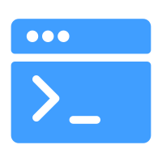

# NovoTerminal v1.0.0

会思考的运维终端 · SSH / RDP / VNC / SFTP · An ops terminal that thinks

[](./LICENSE)


</div>

---

## 中文

### 一、简介

平时项目开发过程中各种类型的服务器资源杂乱，需要用多种工具协同管理，一直想做一个能够统一管理的终端工具，于是便有了 NovoTerminal，支持个性化资产管理，凭证管理，访问方式灵活配置，目前支持SSH，RDP，VNC，SFTP等四种协议访问，SSH内置Agent运维助手、服务器监控面板，同时支持个性化调色盘，与服务器有关的一切都可以交给它。后续会增加更多新的协议支持与功能，敬请期待。

**技术栈**

| 分类 | 选型 |
| --- | --- |
| 运行时 | Electron · Node.js |
| 前端 | Vue · Element UI |
| 构建 | Vite |
| SSH 终端 | xterm.js · ssh2 |
| RDP 引擎 | IronRDP (WASM) |
| VNC 引擎 | noVNC |

### 二、功能介绍

#### 1. 首页与个性化

首页目前有资产统计和最近连接两个组件，能够直观浏览目前资产情况，快捷进行资产连接，支持浅色和深色两种主题自由切换，内置多种字体可供选择。

<div align="center">
  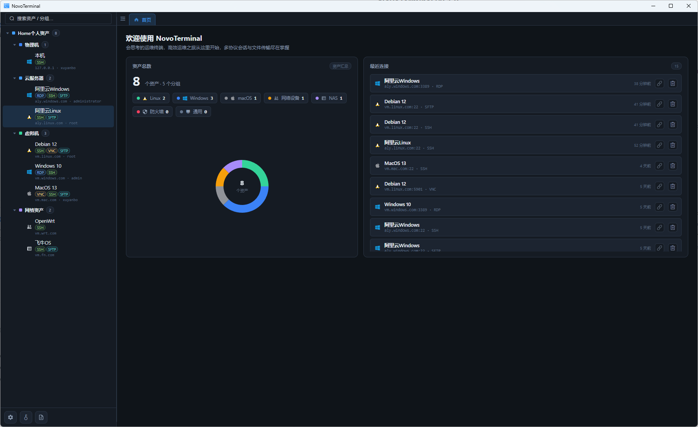
  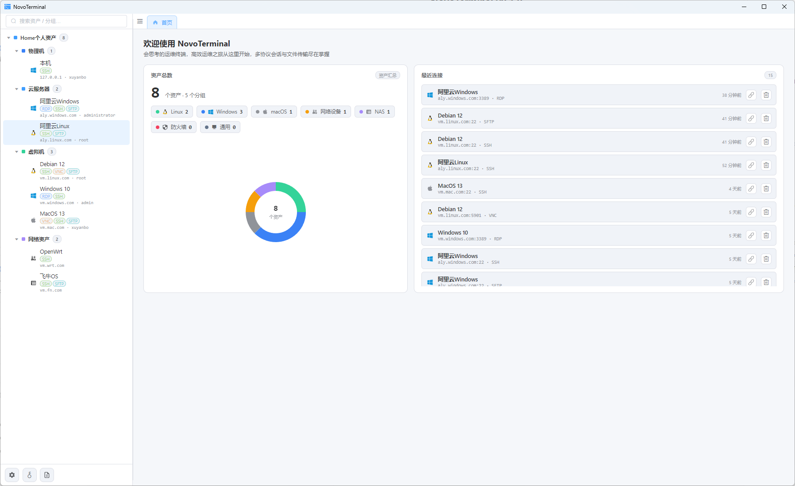
</div>

#### 2. 凭证管理

支持维护账号密码和私钥两种凭据，维护后资产中引用即可使用，编辑查看密码需要经过系统认证，凭据加密落库，安全性可靠。

<div align="center">
  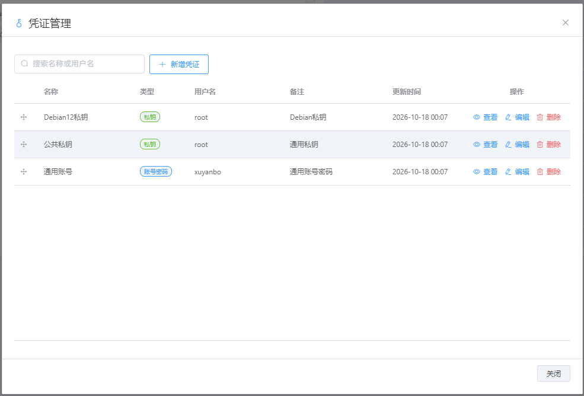
  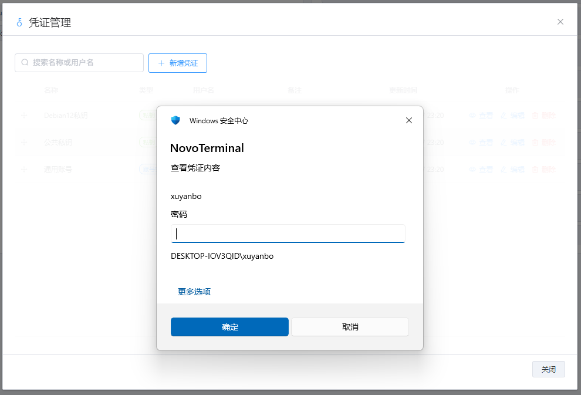
</div>

#### 3. 自定义分组与资产树

支持维护多级分组，随心管理资产，支持分组与资产拖动排序。

<div align="center">
  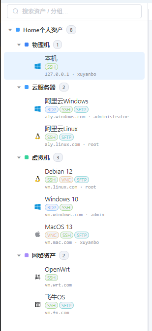
</div>

#### 4. 资产管理

资产凭据支持手动输入、引用凭据管理中的凭据，访问方式随心配置。

<div align="center">
  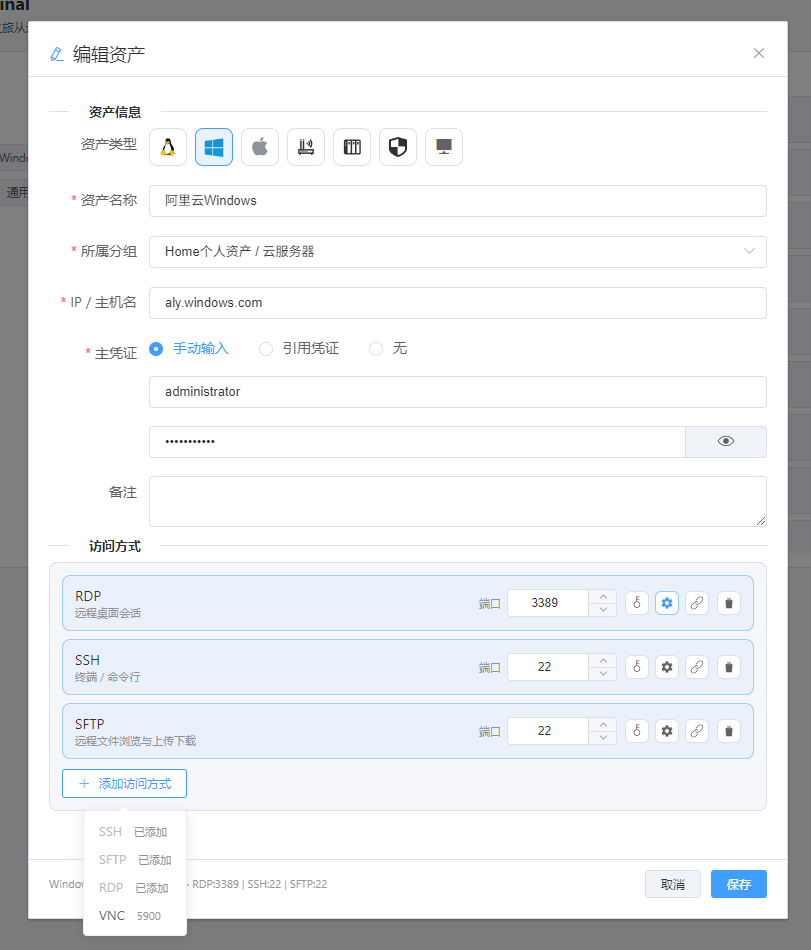
</div>

#### 5. SSH 协议

支持自定义终端配色，内置监控面板及 Agent 运维助手。

<div align="center">
  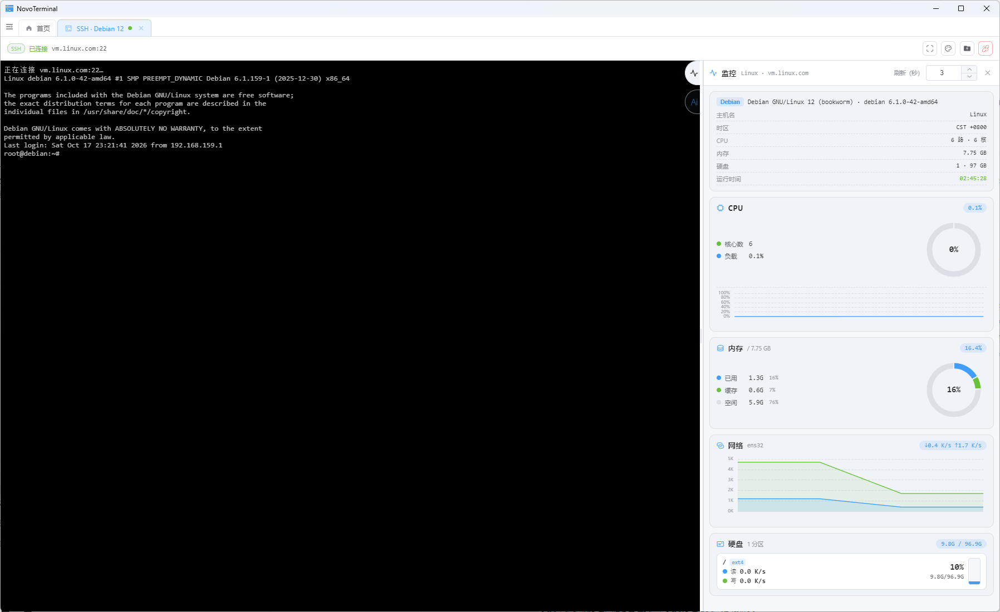
  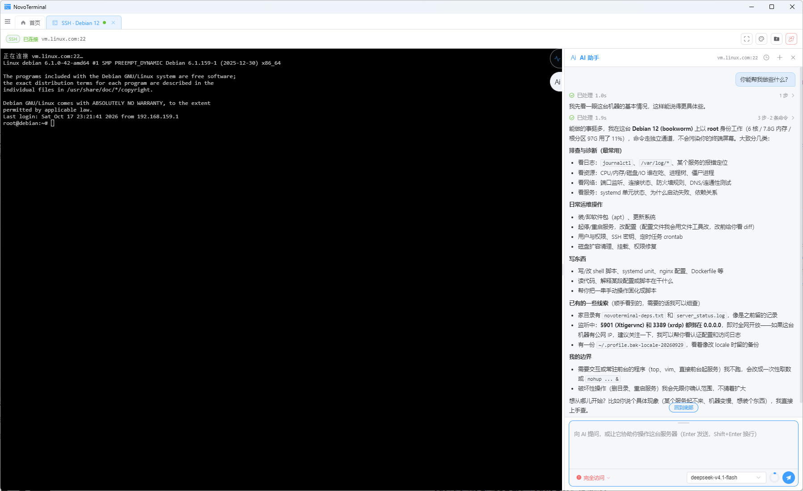
  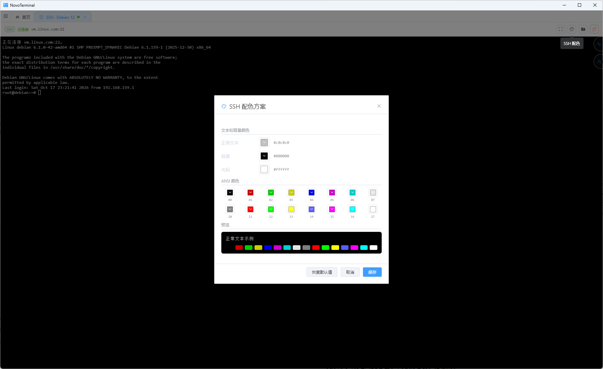
</div>

#### 6. RDP 协议

支持多种引擎可选，内置 IronRDP 引擎，支持 mstsc、wfreerdp 客户端访问，多平台随心配。

<div align="center">
  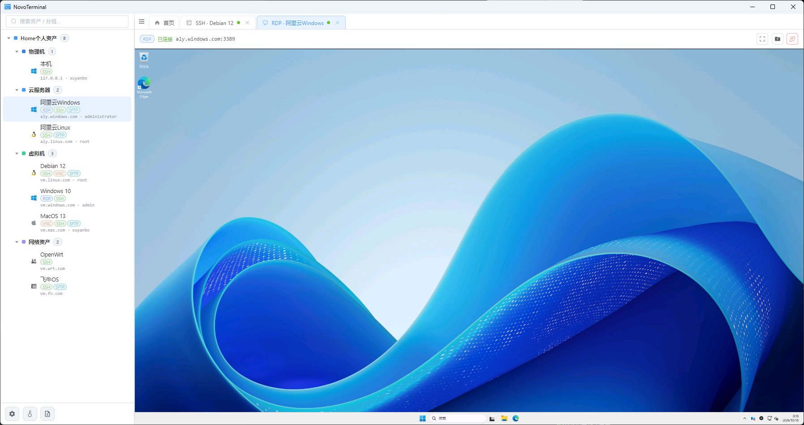
  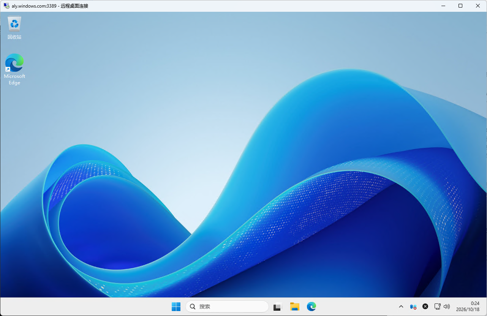
  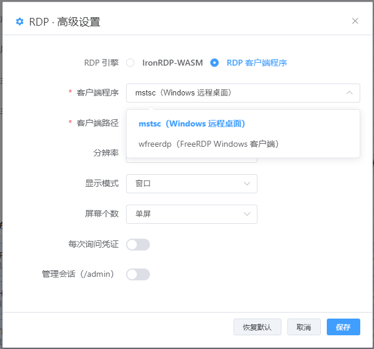
</div>

#### 7. VNC 协议

Linux 共享桌面。

<div align="center">
  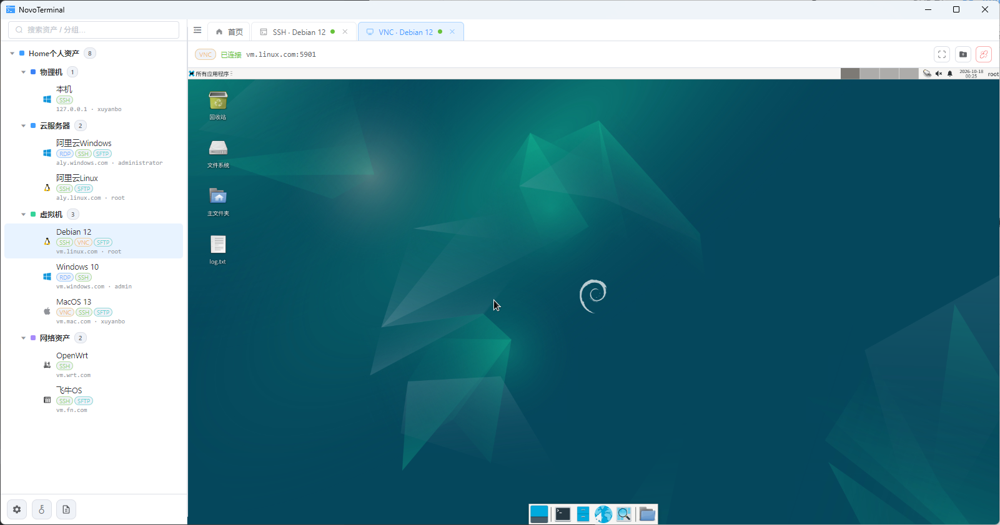
  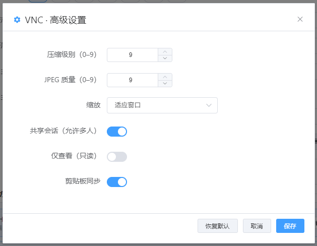
</div>

#### 8. SFTP 文件管理

支持在线文件编辑，文件及文件夹传输，目标服务器多页签管理。

<div align="center">
  
</div>

#### 9. 百变页签栏

浏览器式页签治理，可随心拖出任意页签，多屏幕协同好帮手。

<div align="center">
  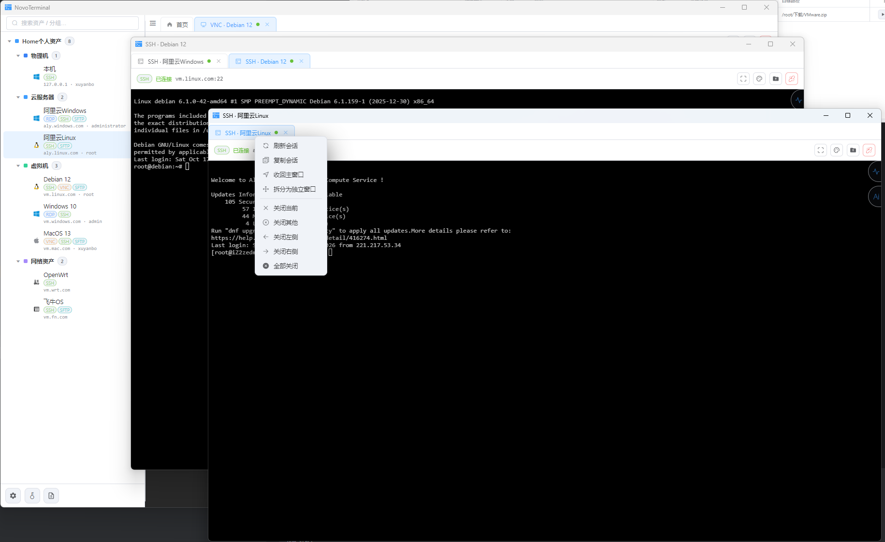
</div>

#### 10. 运行日志

所有操作均有记录，日志数据脱敏处理，密码及凭据绝不进入日志。

<div align="center">
  
</div>

#### 11. 设置

- 支持双语切换，主题切换，字体切换，等个性化设置
- 备份导出与导入，迁移无忧
- AI 助手配置，兼容 OpenAI 标准协议供应商，Ollama 等本地模型同样支持

<div align="center">
  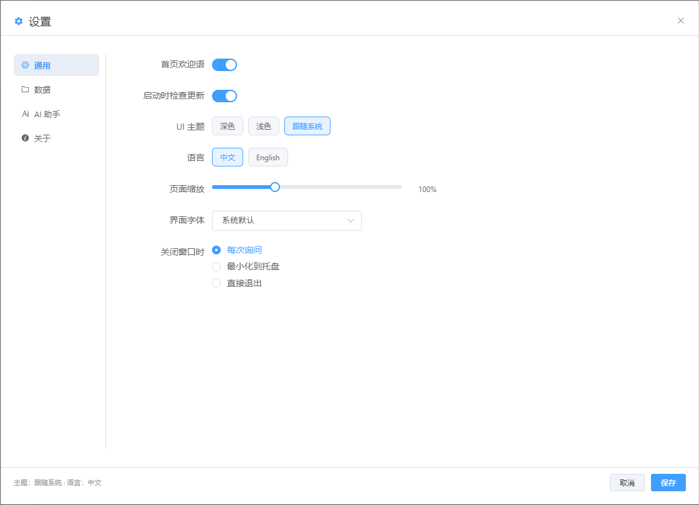
  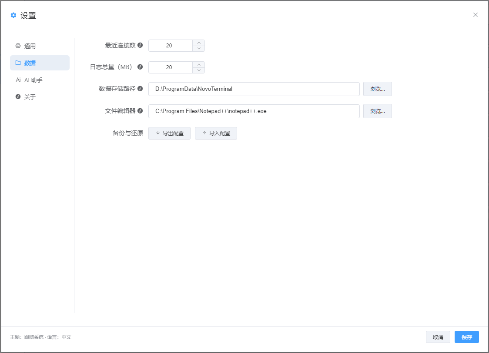
  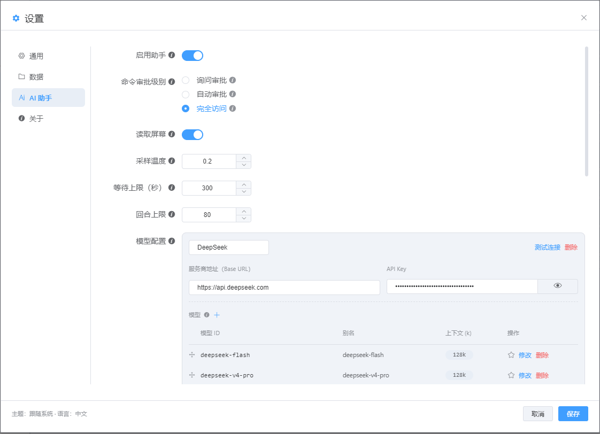
</div>

### 三、运行环境与构建

**运行环境**

| 项目 | 要求 |
| --- | --- |
| Node.js | 18 及以上（Electron 33 / Vite 5） |
| 包管理 | npm（随 Node.js 发行） |
| 操作系统 | Windows 10 及以上、macOS 11 及以上、主流 Linux 发行版；x64 与 arm64 |
| macOS 额外 | Xcode Command Line Tools（编译系统身份认证组件） |
| Linux 打包额外 | `apt-get install -y binutils rpm`；打 AppImage 还需 `mksquashfs` |

**本地运行**

```bash
# 1. 安装依赖
npm install

# 2. 开发：开两个终端，先起 Vite 再起 Electron
npm run dev          # Vite @ http://127.0.0.1:5173
npm run electron     # 另一个终端，连接 dev server

# 3. 生产预览：先构建渲染层，再启动 Electron
npm start
```

**打包发布**

```bash
npm run pack:win     # Windows：nsis + zip，x64 与 arm64 各一份
npm run pack:mac     # macOS：dmg + zip（arm64 / x64）+ universal pkg，需在 macOS 执行
npm run pack:linux   # Linux：deb + rpm + AppImage + tar.xz（x64 / arm64），需在 Linux 执行
```

产物输出到 `release/`（已 gitignore，不入库）。仓库不配置 CI，三个平台都在对应的物理机或虚拟机上手工打包并人工验证；发新版时在 GitHub 创建发行版、上传安装包，标签用 `x.y.z`，同时把 `package.json` 的 `version` 升到同一版本。

国内网络安装 Electron 或 electron-builder 二进制慢时，先设置镜像：

```bash
export ELECTRON_MIRROR=https://npmmirror.com/mirrors/electron/
export ELECTRON_BUILDER_BINARIES_MIRROR=https://npmmirror.com/mirrors/electron-builder-binaries/
```

**其他命令**

| 命令 | 说明 |
| --- | --- |
| `npm run build:renderer` | 生产渲染构建，会生成 `dist/`，不是轻量语法检查 |
| `npm run build:auth:mac` | 仅在 macOS 编译认证组件到 `build/auth` |
| `npm run lint` | 当前只打印占位消息，不能作为静态检查通过的证据 |

改代码前请阅读根目录 [`AGENTS.md`](./AGENTS.md)；本 README 与代码不一致时以代码为准。

---

## English

### 1. Introduction

Server resources scattered across projects are messy and usually need several tools side by side. We wanted one terminal that manages them all, so NovoTerminal was born: personalised asset management, credential management, flexibly configured access methods, and four protocols today — SSH, RDP, VNC and SFTP. SSH ships with a built-in Agent ops assistant and a server monitoring panel, plus a customisable colour palette, so anything related to a server can be handed over to it. More protocols and features are coming — stay tuned.

**Technology stack**

| Category | Choice |
| --- | --- |
| Runtime | Electron · Node.js |
| Frontend | Vue · Element UI |
| Build | Vite |
| SSH terminal | xterm.js · ssh2 |
| RDP engine | IronRDP (WASM) |
| VNC engine | noVNC |

### 2. Features

#### 1. Home & personalisation

The home screen offers two widgets — asset statistics and recent connections — so you can survey your assets at a glance and reconnect quickly. Switch freely between light and dark themes, with several built-in fonts to choose from.

<div align="center">
  
  
</div>

#### 2. Credential management

Keep password and private-key credentials in one place and reference them from your assets. Viewing or editing a password requires system authentication, and credentials are encrypted before they are stored.

<div align="center">
  
  
</div>

#### 3. Custom groups & asset tree

Maintain multi-level groups, organise assets however you like, and drag groups or assets to reorder them.

<div align="center">
  
</div>

#### 4. Asset management

An asset's credential can be entered manually or referenced from credential management, and every access method is configured per asset.

<div align="center">
  
</div>

#### 5. SSH

Custom terminal colour schemes, plus a built-in monitoring panel and the Agent ops assistant.

<div align="center">
  
  
  
</div>

#### 6. RDP

Several engines to pick from: the built-in IronRDP engine together with the mstsc and wfreerdp clients — configure freely on every platform.

<div align="center">
  
  
  
</div>

#### 7. VNC

Shared Linux desktops.

<div align="center">
  
  
</div>

#### 8. SFTP file management

Edit files online, transfer files and whole folders, and manage several target servers through tabs.

<div align="center">
  
</div>

#### 9. Flexible tab bar

Browser-style tab management: drag any session tab out of the bar into its own window — a great companion for multi-monitor work.

<div align="center">
  
</div>

#### 10. Runtime logs

Every operation is recorded, and log data is scrubbed — passwords and credentials never enter the logs.

<div align="center">
  
</div>

#### 11. Settings

- Bilingual UI, theme and font switching, and other personalisation
- Backup export and import, so migrating is easy
- AI assistant configuration, compatible with OpenAI-standard providers; local models such as Ollama are supported too

<div align="center">
  
  
  
</div>

### 3. Environment & build

**Requirements**

| Item | Requirement |
| --- | --- |
| Node.js | 18 or newer (Electron 33 / Vite 5) |
| Package manager | npm (ships with Node.js) |
| OS | Windows 10+, macOS 11+, mainstream Linux distros; x64 and arm64 |
| macOS extra | Xcode Command Line Tools (builds the system authentication helper) |
| Linux packaging extra | `apt-get install -y binutils rpm`; `mksquashfs` for AppImage |

**Run locally**

```bash
# 1. Install dependencies
npm install

# 2. Development — two terminals: Vite first, then Electron
npm run dev          # Vite @ http://127.0.0.1:5173
npm run electron

# 3. Production preview: build the renderer, then run Electron
npm start
```

**Package**

```bash
npm run pack:win     # Windows: nsis + zip, one per arch (x64 and arm64)
npm run pack:mac     # macOS: dmg + zip per arch, plus one universal pkg — must run on macOS
npm run pack:linux   # Linux: deb + rpm + AppImage + tar.xz, x64 and arm64 — must run on Linux
```

Artifacts land in the git-ignored `release/` directory. There is no CI pipeline: each platform is packaged by hand on its own physical machine or VM and verified manually. To ship a release, create it on GitHub with a plain `x.y.z` tag, attach the installers and bump `package.json`'s `version` to match.

**Other commands**

| Command | Notes |
| --- | --- |
| `npm run build:renderer` | Production renderer build, generates `dist/`; not a syntax check |
| `npm run build:auth:mac` | Compiles the authentication helper into `build/auth`, macOS only |
| `npm run lint` | Prints a placeholder message only — not evidence that static checks passed |

Read [`AGENTS.md`](./AGENTS.md) in the repository root before changing code; where this README and the code disagree, the code wins.

## License

Apache-2.0 — see [LICENSE](./LICENSE).
